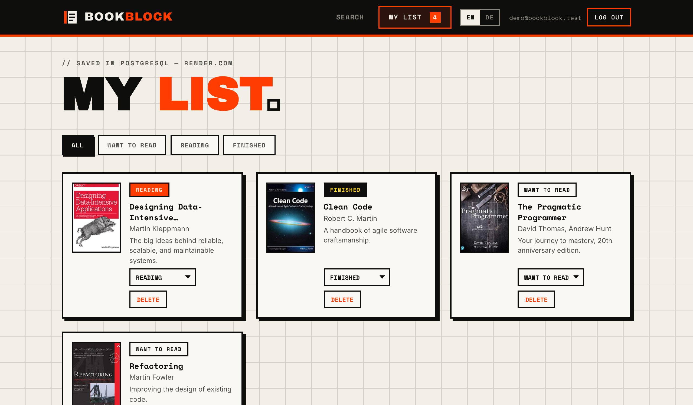
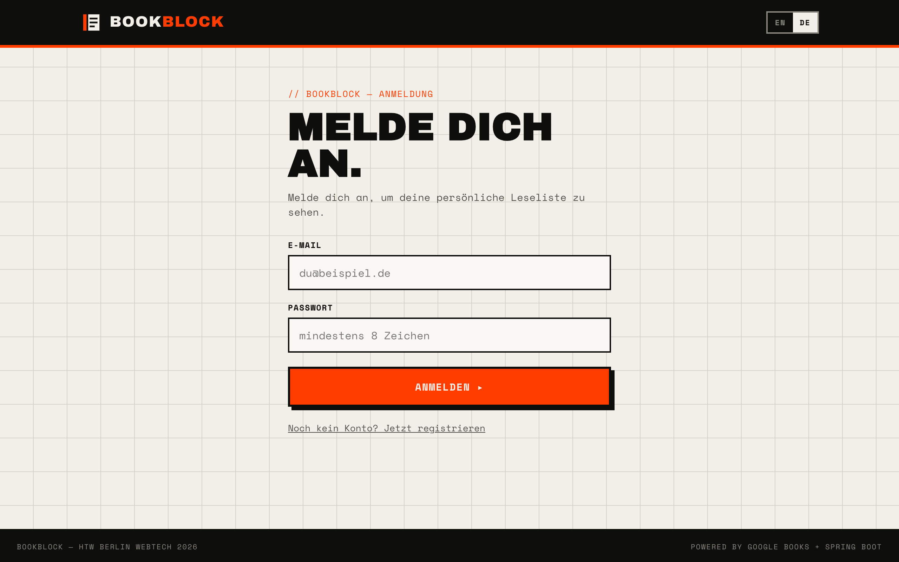
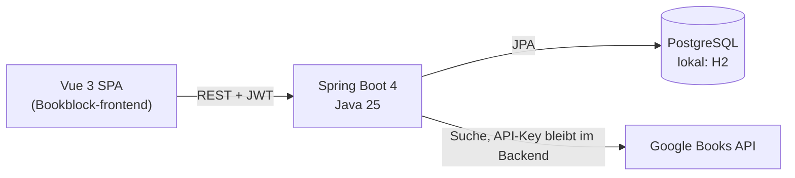

# BookBlock · Backend

[](https://github.com/mazendrop/bookblock-webtech/actions/workflows/ci.yml)

Bücher über die Google Books API suchen und in einer **persönlichen Leseliste** speichern, mit Lesestatus
(„Will ich lesen“, „Lese ich gerade“, „Fertig gelesen“). Projekt im Modul **Webtechnologien an der HTW Berlin**
(Sommersemester 2026). Dieses Repository ist das REST-Backend; das Frontend liegt in
[Bookblock-frontend](https://github.com/mazendrop/Bookblock-frontend).

*English: Spring Boot REST backend for a reading-list app. Own JWT authentication, a Google Books proxy, per-user data, tests and CI.*

| | |
|---|---|
|  |  |
| Leseliste mit Filter nach Status | Anmeldung (Oberfläche auf Deutsch und Englisch) |

## Architektur



- **Eigene Nutzerverwaltung:** Registrierung und Login, Passwörter mit **BCrypt** gehasht, Anmeldung per
  **JWT** (HMAC-SHA256), geprüft von Spring Security als Resource Server.
- **Daten pro Nutzer:** jeder Eintrag gehört dem angemeldeten Nutzer; der Besitzer wird aus dem Token gesetzt, nicht aus der Anfrage.
- **Google Books als Proxy:** das Frontend fragt nur das Backend; der API-Key kommt aus einer Umgebungsvariable und erreicht nie den Browser.
- **Validierung und CORS:** Pflichtfelder per Bean Validation, CORS nur für die konfigurierte Frontend-Adresse.

## REST-API

| Methode | Pfad | |
|---|---|---|
| `POST` | `/auth/register`, `/auth/login` | Konto anlegen / anmelden, liefert ein JWT |
| `GET` | `/search?q=…` | Buchsuche über Google Books |
| `GET` | `/books` | eigene Leseliste |
| `POST` | `/books` | Buch speichern |
| `PUT` | `/books/{id}` | Lesestatus ändern |
| `DELETE` | `/books/{id}` | Buch entfernen |

## Lokal starten

Voraussetzung: JDK 25. Ohne weitere Konfiguration nutzt das Backend eine lokale H2-Datenbank.

```bash
export JWT_SECRET=$(openssl rand -hex 32)        # mindestens 32 Zeichen
export FRONTEND_ORIGIN=http://localhost:5173      # Adresse des Frontends (CORS)
export GOOGLE_BOOKS_API_KEY=…                     # optional, ohne Key drosselt Google schnell
./gradlew bootRun                                 # http://localhost:8080
```

Für PostgreSQL: `SPRING_DATASOURCE_URL`, `SPRING_DATASOURCE_USERNAME`, `SPRING_DATASOURCE_PASSWORD` setzen.
Ein `Dockerfile` für das Deployment liegt bei.

## Tests und CI

```bash
./gradlew test
```

Service-Tests und Sicherheitstests (u. a.: der Controller fragt nur Bücher des angemeldeten Nutzers an, und der
Besitzer wird beim Speichern aus dem Token gesetzt). GitHub Actions baut und testet jeden Push.
